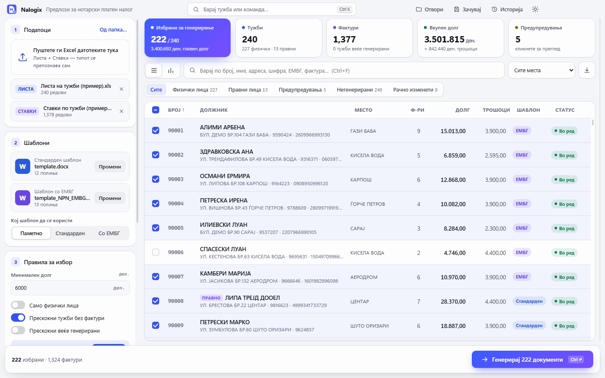
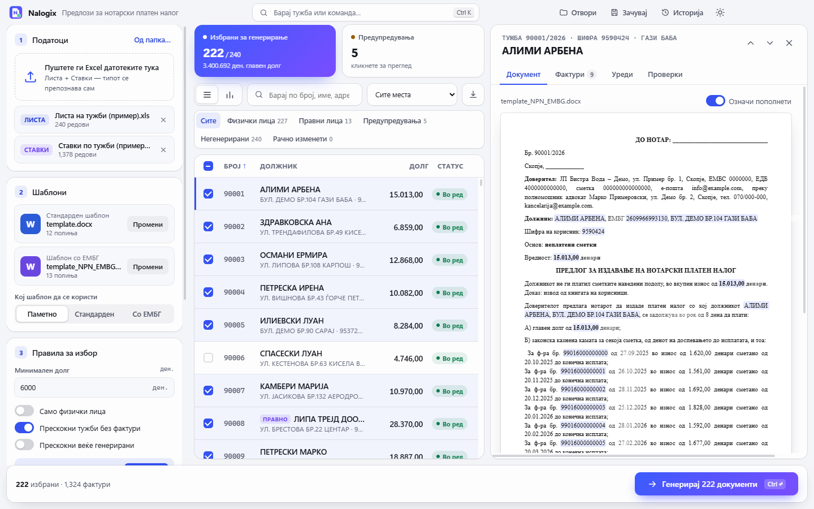
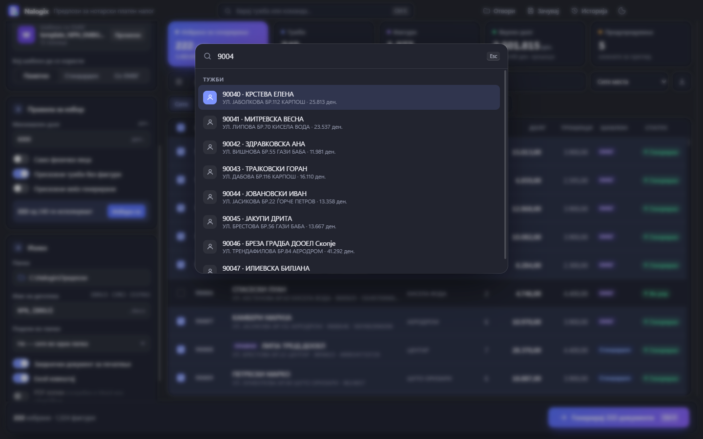
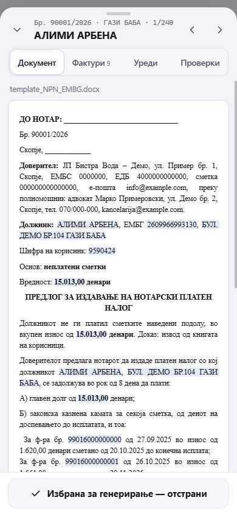

# Nalogix

**Notarial payment-order applications, generated from two Excel exports – on Windows, on a phone and on Android.**

A law office collecting a utility's unpaid bills files one *Предлог за издавање на решение за нотарски платен налог*
per debtor. The utility exports two spreadsheets: **Листа на тужби** (one row per case) and **Ставки по тужби** (one
row per unpaid invoice). Nalogix joins them, checks them, and fills the office's own Word template for every case,
keeping the template's formatting exactly. Everything runs on the user's device; no data is sent anywhere.

> Built with AI assistance (Claude). All data in this repository, its screenshots and its demo is **fictional**.
> The interface is in Macedonian.



## What it does

- **Loads** any number of Excel exports and recognises which is which; a broken file is reported, the rest still load.
- **Checks** before anything is printed: invoices that do not add up, cases without invoices, a customer code used
  twice, ЕМБГ check digits and birth dates.
- **Recognises companies** (legal-form words, a tax number in the ЕМБГ column) and picks the right template, so a
  company never gets "ЕМБГ" in front of its tax number.
- **Previews** the real document for any case, with every value that came from the data highlighted.
- **Corrects** a case inside the app without touching the Excel file; corrections are flagged in the table and report.
- **Selects** by rules (minimum debt, natural persons only, skip cases without invoices or already generated).
- **Generates** one Word file per case, one combined document for printing and an Excel report.
- Desktop extras: projects, history, command palette (Ctrl+K), analytics, PDF through Word or LibreOffice,
  light/dark/system theme. Mobile: offline, installable, output shared as a ZIP.

| Document preview | Dark theme and command palette | Phone |
|---|---|---|
|  |  |  |

## Try it

Requirements: Node.js 24 (see `.nvmrc`). The fictional data is in `samples/`.

```bash
git clone https://github.com/bojanpetkovski18/npn-studio.git
cd npn-studio
npm ci
npx --no install-electron      # Electron 44 downloads its binary on demand
npm start                       # desktop app → add the two Excel files and the templates from samples/
```

Mobile app in a browser: `npm run mobile:dev`, then open `http://127.0.0.1:5173/` and add the files from `samples/`.
Windows installers: `npm run dist` → `dist/Nalogix-Setup.exe` (installs per user, starts in about 0.7 s) and
`dist/Nalogix.exe` (portable). Android: see [docs/ANDROID.md](docs/ANDROID.md).

### Guided tour (desktop)

The screen is built for a lawyer in a hurry: three steps on the left, one status line, a table of number, debtor,
debt and status, and one **Генерирај** button.

1. **Табели** → add both Excel files from `samples/` (240 cases, 1 377 invoices). With two or more tables,
   **Клучна колона** appears right under them: the column the tables are joined on (automatic = Тужба број +
   Година; only columns both tables have and that identify a case are offered). One table on its own is the whole
   source. **Шаблони** → pick `template.docx` and `template_NPN_EMBG.docx`. Every case with invoices is selected:
   239 of 240.
2. The status line says **5 тужби треба да се проверат**; **Прикажи ги** shows only those, each with its reason
   under the name: two invoice sums that do not match, one case without invoices, two cases sharing a customer code.
3. Click any case: **Документ** shows the filled template; **Уреди** corrects a field; **Проверки** decodes the ЕМБГ.
4. **Каде да се зачуваат** → choose a folder, then **Генерирај** → one Word file per case.

Everything else (template mode, a minimum debt, file names, subfolders, print document, Excel report, PDF) is
under the closed **Повеќе опции**, which shows "· изменети" when something there differs from the defaults. The
command palette (Ctrl+K) still has projects, the analytics view and the Excel export.

Every start is empty: no templates, no output folder and every option at its default; only the theme is
remembered. A file-name pattern with an unknown field (for example `NPN_{2}`) is refused, and two documents of one
run never share a file name ("NPN.docx", "NPN (2).docx"…). **Врати почетни поставки** (bottom of the left
panel) returns every setting to that state and keeps the loaded tables; **Исчисти сè** also unloads the data and
forgets the last session. Both ask first, keep the theme and never delete generated documents.

## Template placeholders

`{{BROJ_DOKUMENT}} {{IME}} {{ADRESA}} {{SIFRA}} {{EMBG}} {{VKUPEN_DOLG}} {{FAKTURI_TABELA}} {{VKUPNO_TROSHOCI}}
{{ADVOKAT}} {{NOTAR_TROSOK}} {{NOTAR_NAGRADA}} {{MATERIJAL}} {{TEKOVNA_SOSTOJBA}}`, plus optional `{{GODINA}}
{{SERIJA}} {{DATUM}} {{BROJ_FAKTURI}} {{ZBIR_FAKTURI}} {{VKUPNO_SO_TROSHOCI}}`. Placeholders that Word split across
runs are merged; `{{FAKTURI_TABELA}}` becomes one line per invoice; a hard-coded `,00` after an amount is not doubled.

## Architecture

One engine in plain JavaScript (`src/core`) is shared by all three apps, so a document is byte-for-byte the same
wherever it is generated. Details: [docs/ARCHITECTURE.md](docs/ARCHITECTURE.md).

| Part | Stack | Why |
|------|-------|-----|
| Engine | JavaScript, SheetJS (Excel), JSZip (Word XML) | runs unchanged in Node, browsers and Android's WebView |
| Desktop | Electron 44, plain HTML/CSS/JS | Windows 11 look (Mica, title bar), one language end to end |
| Mobile | PWA (esbuild, Web Worker, IndexedDB, service worker) | offline, installable, no server |
| Android | Capacitor 8 + native share/save | the same bundle as a signed APK |

## Quality

Measured on 2026-11-07 (details and method in [PROGRESS.md](PROGRESS.md)):

- 240 of 240 generated documents byte-identical between the desktop and the mobile engine;
- 48 of 48 mobile acceptance checks (Electron phone emulation) and 16 of 16 on an Android 16 emulator;
- 240 documents in 1.9 s on the emulated phone with the UI thread never stalled more than 21 ms;
- 0 known vulnerabilities in shipped dependencies.

CI (GitHub Actions) runs the engine tests, every mobile phase, a secret scan, workflow lint, an editorconfig check and
a guard that no Excel/Word file outside `samples/` is ever committed: `bash scripts/check.sh`.

## Development

| Command | |
|---------|--|
| `npm run test:all` | engine tests + desktop defaults/reset test + mobile build + mobile phases 1–5 |
| `node samples/generate.js` | regenerate the fictional samples |
| `node test/baseline.js` | fail if any generated document changed |
| `bash scripts/check.sh` | everything CI runs |

Rules for contributors (and AI agents) are in [CLAUDE.md](CLAUDE.md); decisions in [DECISIONS.md](DECISIONS.md);
the mobile phases in [docs/MOBILE_PLAN.md](docs/MOBILE_PLAN.md).

## Limits

- PDF export needs Microsoft Word or LibreOffice on the PC and has not been tested yet.
- No iOS build (needs a Mac); iPhone users will use the web app once it is hosted.
- The Windows exe is not code-signed, so SmartScreen warns on first start.

## Licence

Not chosen yet.
